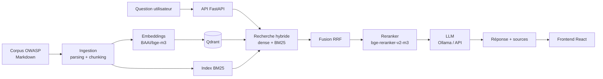

# CyberGuard AI

**CyberGuard AI** est un assistant intelligent de recherche documentaire basé sur le Retrieval-Augmented Generation (RAG) avancé, consacré à la sécurité des applications web. Il répond à des questions en langage naturel à partir du corpus OWASP Cheat Sheet Series, avec des sources vérifiables.

## Contexte académique

Projet fédérateur « IA & Big Data BI » (M2), réalisé à Polytech Intl dans le cadre de notre cursus en ingénierie informatique, pour mettre en pratique nos connaissances en Intelligence Artificielle, RAG et développement d'applications.

## Problème

Les étudiants en informatique et les développeurs juniors doivent souvent consulter plusieurs guides techniques pour trouver des recommandations de sécurité fiables. Une recherche par mots-clés peut manquer une recommandation formulée différemment, et un LLM seul peut produire des réponses plausibles mais non sourcées.

CyberGuard AI permet de poser des questions en langage naturel et retourne des réponses appuyées par des extraits et des références documentaires.

**Persona cible :** un développeur junior qui doit sécuriser l'authentification ou le stockage des mots de passe d'une application web et veut une réponse fiable, avec la source.

## Fonctionnalités prévues

- Recherche documentaire dans un corpus initial de 20 guides OWASP.
- Recherche hybride (sémantique + lexicale), fusion RRF et reranking.
- Réponses générées à partir des passages retrouvés.
- Affichage des sources, sections, liens et extraits.
- Abstention lorsque le corpus ne permet pas de répondre.

## Périmètre

Le projet traite de la sécurité défensive des applications web : authentification, autorisation, injections, validation des entrées, sessions, API, secrets, journalisation et autres bonnes pratiques.

CyberGuard AI est un outil pédagogique. Il ne réalise pas de pentest, n'exécute pas d'exploit et ne remplace pas un audit de sécurité.

## Architecture



### Choix techniques

| Couche | Choix |
|---|---|
| Frontend | React + Vite |
| Backend | Python + FastAPI + Pydantic v2 |
| Ingestion | Python, documents Markdown |
| Embeddings | BAAI/bge-m3 |
| Vector store | Qdrant |
| Recherche lexicale | BM25 |
| Reranking | BAAI/bge-reranker-v2-m3 (si ressources disponibles) |
| LLM | Modèle instruct via Ollama ou fournisseur compatible configurable |
| Déploiement local | Docker Compose |

## Métriques de qualité visées

| Dimension | Métrique | Cible |
|---|---|---|
| Retrieval | Recall@5, NDCG@5 | Recall@5 $\ge 0.85$, NDCG@5 $\ge 0.70$ |
| Génération | Ragas Faithfulness | $\ge 0.85$ |
| Retrieval | Ragas Context Recall | $\ge 0.80$ |
| Performance | Latence First-Token | $< 3\text{ s}$ (à mesurer) |

L'évaluation compare une baseline (recherche vectorielle seule) à la version complète (hybride + RRF + reranking).

## Garde-fous et sécurité

- Réponses fondées uniquement sur le contexte récupéré, avec citations obligatoires.
- Abstention explicite si aucun passage ne soutient la réponse.
- Contenu documentaire traité comme donnée non fiable (protection contre le prompt injection).
- Aucune clé API dans le dépôt : les secrets vont dans un fichier `.env`, ignoré par Git (voir `.env.example`).

## Structure du dépôt

```text
cyberguard-ai/
├── backend/
├── frontend/
├── data/
│   └── raw/                      # corpus OWASP (Markdown)
├── docs/
│   ├── fiche_cadrage_projet.md
│   ├── matrice_moscow_backlog.md
│   ├── pitch_flash_audit.md
│   ├── choix_base_vectorielle.md
│   ├── OWASP_ATTRIBUTION.md
│   └── CORPUS_MANIFEST.md
├── scripts/
│   └── download_owasp_corpus.py
├── docker-compose.yml
├── .env.example
├── .gitignore
└── README.md
```

## Démarrage rapide

Prérequis : Python 3 et Docker.

1. Télécharger le corpus initial (depuis la racine du dépôt) :

   ```bash
   python scripts/download_owasp_corpus.py
   ```

   Le script télécharge les fichiers Markdown depuis le dépôt officiel OWASP. Voir `docs/CORPUS_MANIFEST.md` pour les 20 documents, les liens et les informations de licence.

2. Lancer la base vectorielle locale :

   ```bash
   docker compose up -d
   ```

   Qdrant est ensuite accessible sur `http://localhost:6333`.

## Licence et attribution des données

Le corpus OWASP Cheat Sheet Series est annoncé sous **Creative Commons Attribution-ShareAlike 4.0 International (CC BY-SA 4.0)**. CyberGuard AI conserve les documents sources séparément du code de l'application et doit préserver les attributions, les liens vers les sources, la référence à la licence et les indications de modification.

- Source : https://github.com/OWASP/CheatSheetSeries
- Site : https://cheatsheetseries.owasp.org/
- Licence : https://creativecommons.org/licenses/by-sa/4.0/

Cette indication concerne le corpus OWASP retenu. Les ressources tierces éventuellement incluses dans un document doivent être vérifiées séparément.

## Équipe et responsabilités

| Membre | Rôle | Responsabilités principales |
|---|---|---|
| Hela Kchouk | Lead Data & Frontend | Collecte du corpus, parsing, chunking, métadonnées, interface de chat, Docker Compose |
| Yassmine Nouira | Lead Backend, LLM & Évaluation | API FastAPI, intégration du LLM, citations et abstention, pipeline Ragas, tracing |
| Jihen Ben Rabouche | Lead RAG & Retrieval | Embeddings BGE-M3, indexation Qdrant et BM25, recherche hybride RRF, reranking, dépôt Git |

Encadrant : Haithem Ghazouani.

## Conventions de travail

- Une branche par fonctionnalité (`feat/...`), fusion dans `main` après relecture.
- Messages de commit au format Conventional Commits : `feat:`, `fix:`, `docs:`.