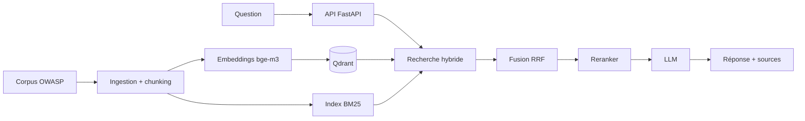

# Fiche de Cadrage d'Ingénierie — CyberGuard AI
## Assistant RAG d'aide à la compréhension de la sécurité des applications web

---

### 1. Fiche d'Identité du Projet

- **Nom du Projet :** CyberGuard AI
- **Intitulé :** Assistant intelligent de recherche documentaire en cybersécurité applicative (Web Application Security).
- **Membres de l'Équipe :**
  1. **Hela Kchouk** — Lead Data / Retrieval
  2. **Yassmine Nouira** — Lead Backend / MLOps
  3. **Jihen Ben Rabouche** — Lead Frontend / Infra
- **Encadrant :** Haithem Ghazouani
- **Lien du Dépôt GitHub :** `https://github.com/jihenrabouch/cyberguard-ai`
- **Branche de travail principale :** `main` (à protéger après configuration des règles de branche).

---

### 2. Cadrage du Problème Métier ("Problem-First")

#### 2.1 Persona Cible & Contexte Opérationnel

- **Utilisateur visé :** Étudiant en informatique ou développeur junior qui développe ou maintient une application web et souhaite comprendre les bonnes pratiques de sécurité.
- **Point de douleur majeur (*Pain point*) :** Les recommandations de sécurité applicative sont dispersées dans de nombreux guides techniques. L'utilisateur doit ouvrir plusieurs pages, parcourir de longs documents et connaître les bons mots-clés pour trouver une recommandation précise (par exemple : prévenir une injection SQL, sécuriser l'authentification ou valider un téléversement de fichier).
- **Limite des approches classiques (Pourquoi l'IA générative et le RAG ?) :** Une recherche par mots-clés ne comprend pas toujours l'intention exprimée en langage naturel et peut manquer les passages qui utilisent des termes différents. Un chatbot généraliste peut produire des réponses non vérifiées ou inventer des recommandations. Le RAG permet de retrouver des extraits dans un corpus sélectionné, de les fournir au modèle pour rédiger une réponse et de présenter les références documentaires utilisées.

#### 2.2 Proposition de Valeur

CyberGuard AI est une application web de question-réponse documentaire qui permet à un étudiant ou développeur junior de poser une question en langage naturel sur la sécurité des applications web. Le système recherche les passages pertinents dans un corpus initial d'au moins 20 guides OWASP, génère une réponse en français ou en anglais à partir des extraits retrouvés et affiche les sources (titre, section, lien et extrait). Si le corpus ne contient pas suffisamment d'informations, l'application doit le signaler au lieu d'inventer une réponse.

**Exemples de questions :**
- Comment prévenir une injection SQL dans une application web ?
- Quelle est la différence entre authentification et autorisation ?
- Quelles précautions prendre lors du téléversement de fichiers ?
- Comment protéger une session utilisateur ?
- Comment sécuriser une API REST ?

**Limites fonctionnelles et de sécurité :**
- Le système fournit une aide pédagogique et documentaire ; il ne remplace pas un audit, un pentest ou un avis professionnel.
- Le périmètre initial est défensif : compréhension des risques et mesures de prévention.
- Pas d'exécution de code, de scan de cible, d'exploitation de vulnérabilités ni de diagnostic automatique d'un site.
- Les réponses doivent être limitées aux informations retrouvées et accompagnées de citations vérifiables.

---

### 3. Données & Volumétrie

- **Source principale :** OWASP Cheat Sheet Series — dépôt officiel `https://github.com/OWASP/CheatSheetSeries` et site `https://cheatsheetseries.owasp.org/`.
- **Licence :** Creative Commons Attribution-ShareAlike 4.0 (CC BY-SA 4.0) ; attributions et liens conservés (voir `docs/OWASP_ATTRIBUTION.md`).
- **Formats des données sources :** [x] Markdown (`.md`) ; [ ] PDF ; [ ] JSON/CSV ; [ ] Tables SQL ; [ ] Images/scans.
- **Volumétrie initiale (PoC S1-S3) :** 20 documents Markdown officiels, avec une cible indicative de 500 à 2 000 chunks après ingestion (à mesurer réellement).
- **Volumétrie cible du projet étudiant :** 20 à 30 documents validés, puis extension éventuelle après contrôle des licences et de la pertinence.
- **Fréquence de mise à jour :** [x] Statique (version figée du dépôt OWASP, pour la reproductibilité).
- **Données personnelles :** aucune dans le corpus.

---

### 4. Architecture Technique & Composants RAG

- **Ingestion :** scripts Python lisant les fichiers Markdown de `data/raw/`, extraction des titres/sections et conservation des métadonnées et liens sources.
- **Stratégie de Chunking :** [x] Recursive Character / découpage récursif respectant autant que possible les titres et sections Markdown.
  - **Taille de chunk visée :** environ 600 tokens.
  - **Overlap visé :** environ 80 tokens.
  - **Justification :** conserver des unités assez petites pour retrouver une recommandation précise, tout en gardant le contexte de la section. Ces valeurs seront ajustées à partir des tests de retrieval.
- **Modèle d'Embeddings :** `BAAI/bge-m3` (multilingue ; dimension annoncée de 1024). Il est retenu pour permettre des questions en français sur un corpus majoritairement anglais. Vérifier la dimension et la configuration lors de l'implémentation.
- **Base vectorielle retenue :** [x] Qdrant.
  - **Justification du choix :** Qdrant fournit une base vectorielle dédiée, des filtres sur les métadonnées, une intégration Python et un déploiement local via Docker. Elle convient à un PoC et permet de filtrer par document ou catégorie.
- **Recherche hybride :** recherche dense (embeddings dans Qdrant) combinée à une recherche lexicale **BM25**, puis fusion des classements par **RRF** (Reciprocal Rank Fusion). BM25 est précis sur les termes techniques (« CSRF », « bcrypt »), la recherche dense gère le sens ; les deux sont complémentaires.
- **Reranker (Cross-Encoder) :** reranking avec `BAAI/bge-reranker-v2-m3` si les ressources matérielles le permettent, sur les 20 meilleurs candidats, avec 5 passages conservés. Le reranker sera évalué avant d'être conservé.
- **LLM de génération :** modèle instruct configurable via Ollama (par exemple `qwen2.5:7b` si les ressources locales le permettent). Prévoir une configuration alternative compatible API si l'environnement local est insuffisant ; ne jamais versionner de clé API.
- **Backend / Frontend :** FastAPI + Pydantic v2 ; React + Vite ; déploiement local via Docker Compose.

---

### 5. Métriques Quantitatives & SLAs

Les valeurs ci-dessous sont des **objectifs de validation**, pas des performances déjà mesurées.

**Jeu d'évaluation :** 80 à 120 questions rédigées et vérifiées manuellement (simples, synonymes, multi-documents, ambiguës, hors corpus), avec la ou les fiches attendues. Les résultats de la version complète (hybride + RRF + reranker) sont comparés à une baseline (recherche vectorielle seule).

| Métrique | Définition / Outil | Objectif cible (KPI) |
| :--- | :--- | :---: |
| **Recall@5 (Retrieval)** | Présence d'au moins un passage de référence pertinent dans les 5 premiers résultats, sur le jeu de questions annoté | ≥ 85 % |
| **NDCG@5 (Retrieval)** | Qualité du classement des passages pertinents parmi les 5 premiers | ≥ 0,70 |
| **Context Recall** | Part des informations nécessaires présentes dans le contexte récupéré ; Ragas | ≥ 0,80 |
| **Faithfulness** | Part des affirmations de la réponse soutenues par le contexte récupéré ; évaluation Ragas + vérification manuelle | ≥ 0,85 |
| **Answer Relevance** | Pertinence de la réponse par rapport à la question ; Ragas + vérification manuelle | ≥ 0,80 |
| **Citations correctes** | Réponses contenant au moins une source exacte | 100 % |
| **Abstention correcte** | Refus de répondre sur les questions hors corpus | ≥ 90 % |
| **Latence First-Token (TTFT)** | Temps d'affichage du premier token en streaming | < 3 s (modèle local), à mesurer |
| **Latence E2E** | Temps entre l'envoi de la question et la réponse complète, mesuré sur l'environnement de test | À mesurer ; objectif initial < 15 s avec modèle local |

---

### 6. Gestion des Risques & Garde-fous

- **Prévention des hallucinations :** réponse strictement fondée sur les extraits récupérés ; afficher les sources ; réponse d'abstention si les éléments sont insuffisants (seuil de score du reranker).
- **Filtrage des données personnelles (PII) :** masquage des e-mails, numéros et clés détectés par expressions régulières avant journalisation des questions ; aucune donnée personnelle dans le corpus.
- **Gestion des accès :** le corpus OWASP est public ; le code et les données sources sont séparés ; l'accès à l'API est protégé par une clé configurée dans l'environnement ; si des documents sensibles sont ajoutés plus tard, un contrôle d'accès par métadonnées sera nécessaire.
- **Injection de prompt :** le contenu des documents est traité comme une donnée non fiable, séparé des instructions système.
- **Protection des secrets :** variables d'environnement dans `.env`, fichier `.env` exclu de Git, fichier `.env.example` sans secret réel.
- **Réseau :** Qdrant non exposé publiquement ; accès limité au réseau interne Docker pendant le PoC.
